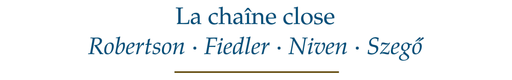

<div lang="fr">

<div align="center">

<picture><source media="(prefers-color-scheme: dark)" srcset="assets/oscuro/titre_completude.png"></picture>
**"La chaîne close — Robertson · Fiedler · Niven · Szegő"**
### Dans ce cadre, les mathématiques sont circulaires et ne divergent pas : `π` entre par `θ_d = π/(d+1)` et revient comme limite `π²/3 − 3`

**Eduardo Nava Hernández · José Arturo Nava Hernández**  
*Dépôt 29 · vérification formelle en Lean 4 · `0 sorry` · imports : Mathlib seul*

[](https://leanprover.github.io/)
[](https://github.com/leanprover-community/mathlib4)
[](Verification/Axioms.lean)
[](https://github.com/leanprover-community/physlib)

</div>

---

> ### Ce que distingue le théorème
>
> Robertson–Schrödinger donne une inégalité. Ici, sur le couple `T_d : P_d`, le quotient
> d'incertitude est calculé en forme close, `C_N(d)`, et son défaut `C_M(d) = C_N(d)² − 1`
> est enfermé dans une bande : nul en `d = 2, 3`, strictement positif dès `d = 4`, croissant,
> et toujours sous la limite de Szegő `π²/3 − 3`, qu'aucun d n'atteint.
>
> <div align="center">
> <picture><source media="(prefers-color-scheme: dark)" srcset="assets/oscuro/plaque_bande.png"></picture>
> </div>
>
> **1 · L'incertitude est un plancher absolu** : `C_M(4) = (94 − 42√5)/5 > 0`, et C_M(d) ≥ C_M(4) pour tout d ≥ 4.
> **2 · Aucune divergence** : `C_M(d) < π²/3 − 3` pour tout d ≥ 4.
> **3 · La chaîne se ferme sur π** : C_M(d) → π²/3 − 3 > 0, car `π > 3`.
> **4 · Le système formel de la chaîne est décidable, complet et cohérent** : pour chaque énoncé φ, φ ou ¬φ est démontré, jamais les deux, et un algorithme sur les entiers dit lequel (`closedSystem`).
>
> C'est un cas isolé : le langage de la chaîne parle de `C_M(d)`, pas de l'arithmétique.
> L'incomplétude de Gödel porte sur les systèmes qui contiennent l'arithmétique ; celui-ci ne la
> contient pas, et il est complet et décidable.

<div align="center">
<picture><source media="(prefers-color-scheme: dark)" srcset="assets/oscuro/plaque_chaine_close.png"></picture>
</div>

---

## Résumé formel

**Forme close.** `C_N(d)²` est une fonction explicite de `θ_d = π/(d+1)`
(`CoherenceConstantSq_closed_form`). Le défaut est `massSq d = C_M(d) = C_N(d)² − 1`.

**Saturation.** `C_N(2)² = C_N(3)² = 1`, donc `C_M(2) = C_M(3) = 0`
(`massSq_two`, `massSq_three`).

**Plancher.** `C_N(4)² = (99 − 42√5)/5`, donc `C_M(4) = (94 − 42√5)/5 > 0`
(`massSq_four_eq`, `massSq_four_pos`).

**Bande.** `C_N²` est strictement croissante sur d ≥ 4 et `C_N(d) < C_N^∞ = √(π²/3 − 2)`
(`CoherenceConstantSq_strictMonoOn_ge_four`, `CoherenceConstant_lt_CoherenceConstantInf`) ;
d'où 0 < C_M(4) ≤ C_M(d) < π²/3 − 3 pour tout d ≥ 4 (`massSq_band`).

**Limite.** C_N(d)² → π²/3 − 2 (`tendsto_CoherenceConstantSq`), donc
C_M(d) → π²/3 − 3 (`tendsto_massSq`), et `π²/3 − 3 > 0` puisque `π > 3` (`massSqInf_pos`).

**Système formel.** Le langage `Sentence` a pour atomes `C_M(d) = 0`, `0 < C_M(d)`, la bande,
`C_M(d) < π²/3 − 3`, `C_M(a) < C_M(b)` et ∀ d ≥ k, 0 < C_M(d), et il est fermé par ¬, ∧, ∨.
Chaque énoncé est décidé par `eval`, qui ne compare que des entiers (`holds_iff_eval`) ;
il est complet (`complete`) et cohérent (`consistent`).

**Clôture.** La chaîne et son système formel réunis : `closedSystem`.

---

## Les étapes

<div align="center">
<picture><source media="(prefers-color-scheme: dark)" srcset="assets/oscuro/plaque_completude_etapes.png"></picture>
</div>

### Étape 1 : l'angle fondamental et la forme close

> **Proposition 1.1.** `C_N(d)²` s'écrit en forme close en `θ_d = π/(d+1)`.

<div align="center">
<picture><source media="(prefers-color-scheme: dark)" srcset="assets/oscuro/plaque_etape1_forme_close.png"></picture>
</div>

*Modules formels :* [`Szego.lean`](src/AntiGodelCompleteness/Szego.lean) (`CoherenceConstantSq_closed_form`, `CoherenceConstantSq_sinc_form`).  
Définition directe ; la forme en `sinc` retire la singularité apparente.

### Étape 2 : saturation en d = 2, 3

> **Proposition 2.1.** `C_M(2) = C_M(3) = 0`.

<div align="center">
<picture><source media="(prefers-color-scheme: dark)" srcset="assets/oscuro/plaque_etape2_saturation.png"></picture>
</div>

*Modules formels :* [`Szego.lean`](src/AntiGodelCompleteness/Szego.lean) (`CoherenceConstantSq_two`, `CoherenceConstantSq_three`) ;
[`AntiGodelCompleteness.lean`](src/AntiGodelCompleteness.lean) (`massSq_two`, `massSq_three`).  
`cos(π/3)`, `cos(π/4)` exacts.

### Étape 3 : le plancher en d = 4

> **Proposition 3.1.** `C_M(4) = (94 − 42√5)/5 ≈ 0,017029 > 0`.

<div align="center">
<picture><source media="(prefers-color-scheme: dark)" srcset="assets/oscuro/plaque_etape3_plancher.png"></picture>
</div>

*Modules formels :* [`Szego.lean`](src/AntiGodelCompleteness/Szego.lean) (`CoherenceConstantSq_four_eq`, `one_lt_CoherenceConstantSq_four`) ;
[`AntiGodelCompleteness.lean`](src/AntiGodelCompleteness.lean) (`massSq_four_eq`, `massSq_four_pos`).  
`cos(π/5) = (1 + √5)/4`, puis `√5 < 47/21`.

### Étape 4 : la bande

> **Proposition 4.1.** Pour tout d ≥ 4, 0 < C_M(4) ≤ C_M(d) < π²/3 − 3.

<div align="center">
<picture><source media="(prefers-color-scheme: dark)" srcset="assets/oscuro/plaque_etape4_bande.png"></picture>
</div>

*Modules formels :* [`Monotonicity.lean`](src/AntiGodelCompleteness/Monotonicity.lean) (`CoherenceConstantSq_strictMonoOn_ge_four`, `CoherenceConstant_lt_CoherenceConstantInf`) ;
[`AntiGodelCompleteness.lean`](src/AntiGodelCompleteness.lean) (`massSq_band`).  
Signe de la dérivée par bornes de Taylor certifiées et `3 < π < 22/7`, sans balayage numérique.

### Étape 5 : π revient comme limite

> **Proposition 5.1.** C_M(d) → π²/3 − 3 = (C_N^∞)² − 1, et `π²/3 − 3 > 0`.

<div align="center">
<picture><source media="(prefers-color-scheme: dark)" srcset="assets/oscuro/plaque_etape5_limite.png"></picture>
</div>

*Modules formels :* [`Szego.lean`](src/AntiGodelCompleteness/Szego.lean) (`tendsto_CoherenceConstantSq`) ;
[`AntiGodelCompleteness.lean`](src/AntiGodelCompleteness.lean) (`tendsto_massSq`, `massSqInf_pos`, `massSqInf_eq_sq`, `closedChain`).  
`π > 3` vient de Mathlib ; la limite est celle des espaces finis, jamais atteinte (Étape 4).

### Étape 6 : le système formel est décidable, complet et cohérent

> **Théorème 6.1.** Pour tout énoncé φ du langage de la chaîne, `Holds φ ↔ eval φ = true` ;
> donc φ ou ¬φ est vrai, jamais les deux, et la réponse se calcule.

<div align="center">
<picture><source media="(prefers-color-scheme: dark)" srcset="assets/oscuro/plaque_systeme_formel.png"></picture>
</div>

*Modules formels :* [`AntiGodelCompleteness.lean`](src/AntiGodelCompleteness.lean) (`holds_iff_eval`, `complete`, `consistent`, `closedSystem`).  
Chaque atome se ramène à une comparaison d'entiers par les Étapes 2–5 (`holds_gap_iff`, `holds_lt_iff`, `holds_gapFrom_iff`) ; récurrence sur φ pour ¬, ∧, ∨.
Le noyau démontre alors un énoncé sur les réels par calcul :

```lean
example : Sentence.Holds (.lt 2 5) := by decide   -- C_M(4) < C_M(7)
```

---

## Physlib : pull requests fusionnées

| PR | Module Physlib | Étape | Module du corpus |
|---|---|---|---|
| [#1734](https://github.com/leanprover-community/physlib/pull/1734) | `TightBindingChain/LongChainLimit` | 5 | `D8_Szego.lean` |
| [#1735](https://github.com/leanprover-community/physlib/pull/1735) | `TightBindingChain/LongChainMonotonicity` | 4 | `D9_Monotonicity.lean` |

---

## Catalogue des modules Lean

| Module | Déclaration | Signification | Statut |
|---|---|---|---|
| [`Szego.lean`](src/AntiGodelCompleteness/Szego.lean) | `CoherenceConstantSq_closed_form` | forme close de `C_N(d)²` | `0 sorry` |
| [`Szego.lean`](src/AntiGodelCompleteness/Szego.lean) | `tendsto_CoherenceConstantSq` | `C_N(d)² → π²/3 − 2` | `0 sorry` |
| [`Monotonicity.lean`](src/AntiGodelCompleteness/Monotonicity.lean) | `CoherenceConstantSq_strictMonoOn_ge_four` | croissance stricte sur `d ≥ 4` | `0 sorry` |
| [`Monotonicity.lean`](src/AntiGodelCompleteness/Monotonicity.lean) | `CoherenceConstant_lt_CoherenceConstantInf` | `C_N(d) < C_N^∞` | `0 sorry` |
| [`AntiGodelCompleteness.lean`](src/AntiGodelCompleteness.lean) | `massSq_band` | `0 < C_M(4) ≤ C_M(d) < π²/3 − 3` | `0 sorry` |
| [`AntiGodelCompleteness.lean`](src/AntiGodelCompleteness.lean) | `tendsto_massSq` | `C_M(d) → π²/3 − 3` | `0 sorry` |
| [`AntiGodelCompleteness.lean`](src/AntiGodelCompleteness.lean) | `closedChain` | saturation, plancher, bande, limite | `0 sorry` |
| [`AntiGodelCompleteness.lean`](src/AntiGodelCompleteness.lean) | `holds_iff_eval` | chaque énoncé est décidé par `eval` | `0 sorry` |
| [`AntiGodelCompleteness.lean`](src/AntiGodelCompleteness.lean) | `complete` | `φ` ou `¬φ` | `0 sorry` |
| [`AntiGodelCompleteness.lean`](src/AntiGodelCompleteness.lean) | `consistent` | jamais `φ` et `¬φ` | `0 sorry` |
| [`AntiGodelCompleteness.lean`](src/AntiGodelCompleteness.lean) | `closedSystem` | la chaîne et son système formel | `0 sorry` |

`Szego.lean` et `Monotonicity.lean` sont `D8_Szego.lean` et `D9_Monotonicity.lean` du
[dépôt de base](https://github.com/naype888-cloud/nava-robertson-schrodinger), copiés sans
modification (seul l'import de `D9` est renommé). La forme close de `C_N(d)` provient de la
chaîne Robertson → Fiedler → Niven du dépôt de base (`D0`–`D7`).

---

## 🏛️ La mosaïque

| Dépôt | Objet |
|:---|:---|
| [`00 · bacqm-substrate`](https://github.com/naype888-cloud/bacqm-systems) | Substrat matériel & moteur du noyau Linux : modules de mémoire dynamiques en temps réel |
| [`01 · nava-robertson-schrodinger`](https://github.com/naype888-cloud/nava-robertson-schrodinger) | Le canon : l'incertitude élémentaire dimensionnelle sur le cube ouvert, ℂᵈ ⊗ ℂᵈ ⊗ ℂᵈ |
| [`02 · Proper-Time-General-Relativity`](https://github.com/naype888-cloud/Proper-Time-General-Relativity) | Le temps compte les pas : τ = 1/(φ\|t\|) à quatre sites ; masse effective, équivalence, gravitation |
| [`03 · nrs3-mandelstam-tamm-cramer-rao`](https://github.com/naype888-cloud/nrs3-mandelstam-tamm-cramer-rao) | Mandelstam–Tamm et Cramér–Rao : aucun état n'est orthogonal à lui-même avant πħ/(2ΔE) |
| [`04 · YM-By-Perelmans-surgery-method`](https://github.com/naype888-cloud/YM-By-Perelmans-surgery-method) | Yang–Mills sur réseau : loi d'aire uniforme, matrice de transfert, défaut de fibre (`0 sorry`) |
| [`05 · nrs3-tightbinding`](https://github.com/naype888-cloud/nrs3-tightbinding) | La chaîne de Physlib, le cube ouvert et la table périodique (H–Og), un cube 3D par élément |
| [`06 · nrs3-cristales`](https://github.com/naype888-cloud/nrs3-cristales) | Cristaux : la symétrie donne la forme de Σ et Ω, le spectre donne la taille |
| [**07 · nrs3-completude**](https://github.com/naype888-cloud/nrs3-completude) | Complétude constructive et limites spectrales par Robertson–Fiedler–Niven–Szegő *(ce dépôt)* |
| [`08 · nrs3-golab`](https://github.com/naype888-cloud/nrs3-golab) | Gołąb, les deux extrêmes : π = 3 (hexagone), 4 (carré) ; produit scalaire → π exact ; stabilité en d = 3 |
| [`09 · nrs3-de-sitter`](https://github.com/naype888-cloud/nrs3-de-sitter) | Cosmologie de Sitter : rayon d'horizon L_dS, constante cosmologique positive et courbure |
| [`10 · nrs3-bekenstein`](https://github.com/naype888-cloud/nrs3-bekenstein) | Thermodynamique des trous noirs : frontière à bits, entropie de Bekenstein–Hawking saturée |
| [`11 · nrs3-landauer-carnot`](https://github.com/naype888-cloud/nrs3-landauer-carnot) | Limite de Landauer et cycle de Carnot : coût d'effacement d'un bit et dissipation minimale |
| [`12 · nrs3-penrose`](https://github.com/naype888-cloud/nrs3-penrose) | Effondrement gravitationnel de Diósi–Penrose : temps de décohérence par auto-énergie |
| [`13 · nrs3-rovelli-lqg`](https://github.com/naype888-cloud/nrs3-rovelli-lqg) | Gravité quantique à boucles : spectre d'aire discrète, opérateur de surface et saturation de spin |
| [`14 · nrs3-uncertainty-cone`](https://github.com/naype888-cloud/nrs3-uncertainty-cone) | Cône de lumière futur et cercle de Minkowski : structure causale sous revêtement SL(2, ℂ) |
| [`15 · lean4-commits`](https://github.com/naype888-cloud/lean4-commits) | 53 PRs fusionnées dans leanprover-community/physlib : catalogue de preuves formelles, `0 sorry`, ZFC |

---

## Chronologie

| Année | Événement | Dépôt associé |
|---|---|---|
| 1915–20 | Szegő : théorèmes limites pour matrices de Toeplitz | **ce dépôt** · [dépôt de base](https://github.com/naype888-cloud/nava-robertson-schrodinger) |
| 1927 | Relation d'incertitude de Heisenberg ; Solvay | |
| **1929–30** | **Robertson et Schrödinger : l'inégalité d'incertitude** | [dépôt de base](https://github.com/naype888-cloud/nava-robertson-schrodinger) |
---

## Compilation et certification du noyau

Lean 4 `v4.35.0`, Mathlib `v4.35.0`. Aucun autre import.

```bash
lake exe cache get
lake build
lake env lean Verification/Axioms.lean
# 'Gnomon.closedSystem' depends on axioms: [propext, Classical.choice, Quot.sound]
```

`0 sorry`, aucun axiome ad hoc, `autoImplicit = false`.
---

## Licence

NRS Noncommercial License 1.0.0, voir [`LICENSE`](LICENSE).

---

<div align="center">

### 📐 *« Dans ce cadre, les mathématiques sont circulaires et ne divergent pas : π entre par θ_d = π/(d+1) et revient comme limite π²/3 − 3. »*

**Eduardo Nava Hernández · José Arturo Nava Hernández** · [naype888-cloud](https://github.com/naype888-cloud)

</div>

</div>
